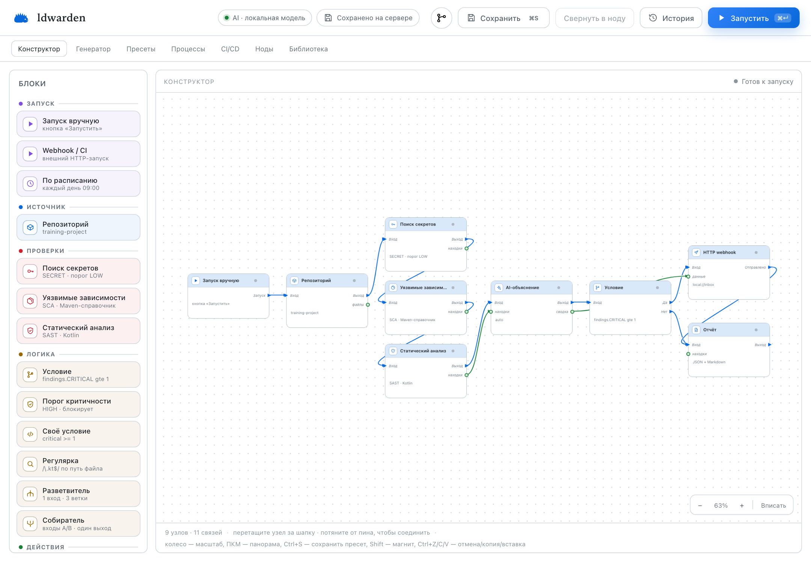
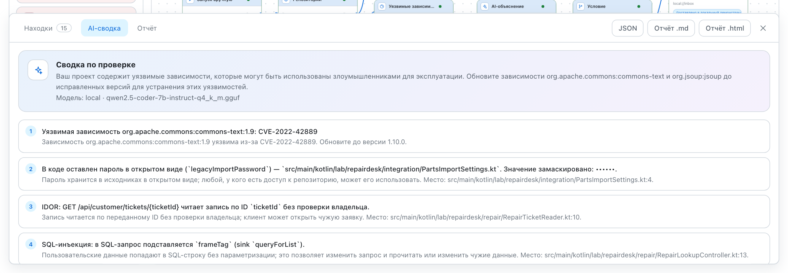
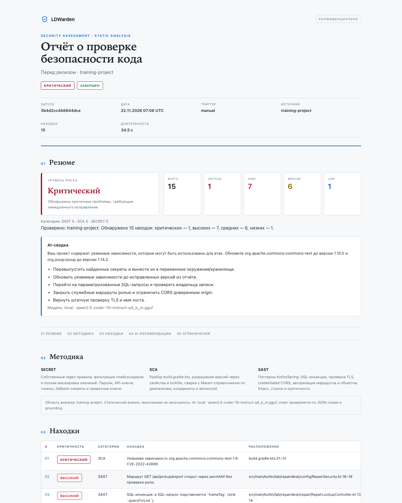
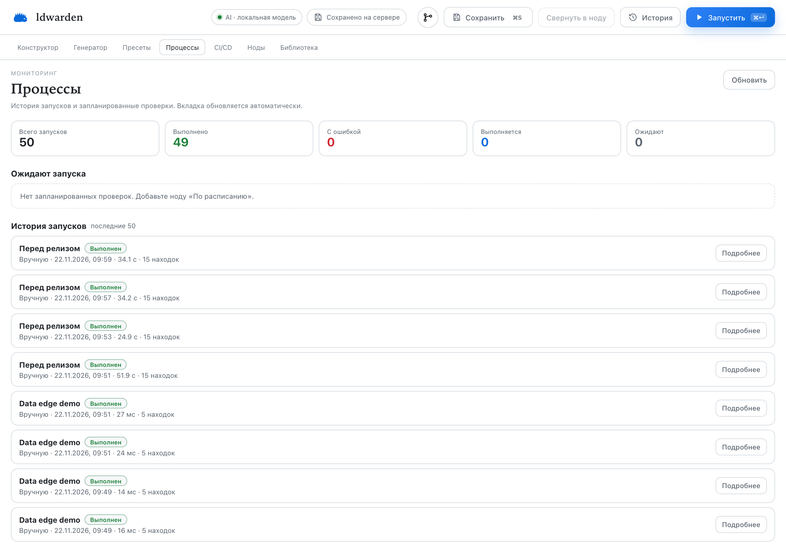

# LDWarden

**AI Security Workflow — визуальная платформа автоматизации проверок безопасности.**

Соберите сценарий из нод, запустите собственные анализаторы SECRET / SCA / SAST для Kotlin · Spring Boot · Gradle, получите объяснения AI и готовый отчёт для команды.

[Презентация](docs/LDWarden-pitch.pptx) · [Быстрый старт](#быстрый-старт) · [Архитектура](#архитектура) · [Соответствие ТЗ](#соответствие-тз)



## Проблема

Небольшие команды выпускают быстро, и безопасность кода держится на внимательности разработчиков:

- секреты, пароли и токены остаются в репозитории;
- устаревшие зависимости содержат опубликованные CVE;
- встречаются ошибки авторизации: открытые маршруты, IDOR, широкий CORS, отключённая проверка TLS.

Корпоративные сканеры дороги, сложны в настройке и требуют экспертизы. В результате проверка откладывается, а ошибки всплывают после релиза.

**Целевой пользователь:** разработчик, тимлид или security champion в небольшой команде, которому нужен понятный отчёт и конкретные шаги исправления, а не ещё один сложный инструмент.

## Решение

LDWarden — конструктор автоматических проверок без написания кода:

1. **Источник** — папка, ZIP или Git-репозиторий.
2. **Проверки** — собственные анализаторы SECRET, SCA и SAST.
3. **AI-анализ** — объяснение рисков простым языком и рекомендации по исправлению.
4. **Отчёт** — JSON / Markdown / SARIF / HTML и уведомление в Telegram или webhook.



## Возможности

- drag-and-drop конструктор сценариев с портами, связями, ветвлением и условиями;
- триггеры: вручную, по расписанию, webhook / CI;
- собственные анализаторы без Semgrep / Gitleaks / Trivy и готовых наборов правил;
- AI-объяснения с проверкой JSON-схемы и grounding (без выдуманных CVE);
- живые статусы узлов, история запусков и просмотр данных на связях;
- Telegram-отчёт файлом `.html`, HTTP webhook и демо-ящик;
- свои ноды: HTTP, AI-промпт и композитные;
- библиотека шаблонов и нод в GitHub;
- CI/CD-конфиги для GitHub Actions и GitLab CI;
- генератор сценария по текстовому описанию;
- локальная LLM или любой OpenAI-совместимый API;
- пять тем оформления, включая GitHub и GitHub Dark.

## Быстрый старт

Нужен Python 3.10+ (проверено на 3.14).

```bash
./start.sh
```

Первый запуск создаст `venv`, установит зависимости и поднимет сервер на <http://127.0.0.1:8000>. Повторный запуск:

```bash
./start.sh --no-install
```

- macOS: двойной клик по `LDWarden.command`;
- Windows: `start.bat`;
- порт: `LDWARDEN_PORT=9000 ./start.sh` или `./LDWarden.command`.

Дальше:

1. откройте вкладку **«Пресеты»** и выберите **«Перед релизом»**;
2. нажмите **«Запустить»**;
3. смотрите находки, AI-сводку и отчёт в нижней панели;
4. при необходимости настройте Telegram и отправьте HTML-отчёт файлом.

### Демо-данные

В репозитории уже есть учебный проект `training-main/`: Kotlin/Spring Boot
приложение Pavilion Scheduler. Справочник уязвимостей Maven встроен в приложение
(`app/vulnerability-database/`), поэтому отдельная папка в учебном проекте не нужна.

## Ноды

| Категория | Ноды |
|---|---|
| Запуск | Вручную · По расписанию · Webhook / CI |
| Источник | Папка или Git-репозиторий · ZIP-загрузка |
| Проверки | Секреты · SCA · SAST Kotlin/Spring |
| Логика | Условие · Своё условие · Регулярка · Ветвление · Сборка · Порог критичности |
| AI | AI-объяснение: сводка, риски, рекомендации |
| Отчёт | Markdown · JSON · SARIF · HTML |
| Уведомления | Telegram · HTTP webhook |
| Свои ноды | HTTP · AI-промпт · Композитная |

Каждая нода — декларативная спецификация: `NodeSpec`, `ParamSpec`, `HandleSpec`. Движок валидирует параметры и граф, а результат каждой ноды виден в «Процессах» и в инспекторе.

## Анализаторы

### SECRET

- собственные regex-правила и фильтр плейсхолдеров;
- пароли, API-ключи, токены, fallback-секреты, восстановимые токены, приватные ключи, строки подключения;
- значения полностью маскируются в UI, логах и отчётах (`••••••`).

### SCA

- парсер `build.gradle.kts` (Kotlin DSL);
- разрешение версий через `gradle.properties`, переменные и `gradle.lockfile`;
- сверка с Maven-справочником по нормализованным диапазонам;
- `group`, `artifact`, `version`, `advisoryId` (CVE или GHSA).

### SAST

- Kotlin/Spring-паттерны: SQL-инъекции, проверка TLS, credentialed CORS, авторизация маршрутов и объектов;
- класс находки, строка, диапазон и критичность;
- control-примеры не попадают в отчёт.

На текущем учебном проекте: **9 находок — 3 SECRET, 5 SCA, 1 SAST**.

## AI

- локальная модель Qwen2.5-Coder-7B через llama.cpp;
- Ollama и любой OpenAI-совместимый API;
- модель получает только обезличенные находки, без значений секретов;
- ответ проверяется по JSON-схеме;
- grounding: `finding_id`, пути и строки должны существовать, CVE/GHSA сверяются с находками;
- выдуманные CVE отбрасываются, при сбое используется детерминированный fallback.

Переключение — через `.env`:

```env
LDWARDEN_LLM_PROVIDER=auto        # auto | local | openai | ollama | universal
LDWARDEN_LLM_MODEL_PATH=llms/qwen2.5-coder-7b-instruct-q4_k_m.gguf
LDWARDEN_LLM_BASE_URL=
LDWARDEN_LLM_API_KEY=
LDWARDEN_LLM_MODEL=
```

Локальная модель:

```bash
./venv/bin/pip install -r requirements-ai.txt
```

## Отчёты

- **JSON** — `{"findings": [...]}` по формату организаторов;
- **Markdown** — читаемый отчёт для быстрого просмотра;
- **HTML** — самодостаточный файл для браузера и печати в PDF;
- **SARIF** — для интеграции с CI.

JSON и читаемый отчёт строятся из одного набора находок. Значения секретов в JSON отсутствуют, в Markdown/HTML — полностью скрыты.

HTML-отчёт оформлен как формальный документ: титул, резюме, методика, таблица находок, подробности, AI-рекомендации и ограничения. Стиль автоматически совпадает с текущей темой сайта — **Сакура, GitHub, GitHub Dark, Варден или Чёрно-белая**. Для HTML-файла в Telegram стиль выбирается в ноде **«Отчёт»**.



## Уведомления

- **Telegram** — HTML-отчёт файлом `ldwarden-report.html` с подписью-итогом; текст уходит в MarkdownV2.
- **HTTP webhook** — `http(s)://` или `local://inbox` для демонстрации.

Токены шифруются на сервере и маскируются в интерфейсе.

## Расписание

Нода **«По расписанию»** запускает сценарий один раз в выбранную дату и время или регулярно по дню недели. Время считается в выбранном часовом поясе (по умолчанию `Europe/Moscow`).

Планировщик проверяет расписание каждые 30 секунд, пока сервер запущен. Кнопка **«Когда сработает?»** показывает ближайший запуск. Сценарий должен быть сохранён и не быть шаблоном/опубликованным.

## Свои ноды

Вкладка **«Ноды»** — конструктор собственных блоков:

- **HTTP** — запрос к API по шаблону (`{{params.x}}`, `{{findings.total}}`, `{{run.id}}`), таймаут и маппинг находок из JSON;
- **AI** — свой промпт к локальной или внешней модели;
- **Композитная** — выделите ноды на холсте и нажмите «Свернуть в ноду»; редактирование — на основном холсте.

HTTP-ноды ходят только на разрешённые хосты. Список редактируется в **«Сетевые правила»** (по умолчанию `api.github.com`, `raw.githubusercontent.com`, `127.0.0.1`, поддерживаются `*.example.com`).

Каждая нода экспортируется отдельным `.node.json`; импорт обновляет её по id и поднимает версию.

## Библиотека

В библиотеке два типа объектов — **пресеты** и **ноды**, фильтр «Все / Пресеты / Ноды» с количеством:

- публикация сценария вместе с его нодами;
- отдельная публикация ноды кнопкой «В библиотеку»;
- установка ноды одной кнопкой;
- версии и автообновление при импорте.

```env
LDWARDEN_LIBRARY_REPO=owner/ldwarden-library
LDWARDEN_LIBRARY_BRANCH=main
LDWARDEN_LIBRARY_PATH=presets
LDWARDEN_LIBRARY_TOKEN=github_pat_...
```

## CI/CD

Вкладка **«CI/CD»** генерирует готовый конфиг для GitHub Actions или GitLab CI:

- запуск workflow через `POST /api/ci/run`;
- `X-CI-Token` и `LDWARDEN_CI_TOKEN`;
- exit code: `0` — успех, `1` — ошибка или непройденный порог, `2` — отмена;
- отчёты и артефакты в пайплайне.

## Генератор сценариев

Вкладка **«Генератор»**: опишите задачу текстом — LLM соберёт упорядоченный AST, детерминированный composer превратит его в валидный граф. Модель не придумывает ID, координаты и провода.

## Процессы и данные



- история запусков со статусами «Выполнен», «Ошибка», «Отменён», «Выполняется»;
- ожидающие запуски по расписанию;
- «Подробнее»: узлы, находки, порог, ошибки, JSON / MD / HTML;
- клик по проводу → **«Данные связи»**: источник, приёмник, порт, статус, размер и JSON payload.

## Архитектура

```
┌──────────────────────────┐
│ SPA (ES-модули, без сборки) │
└─────────────┬────────────┘
              │ REST / SSE / CI
┌─────────────▼────────────┐      ┌─────────────────────┐
│ Flask API                │─────▶│ SQLite: запуски,     │
│ runs · workflows · CI    │      │ история, настройки   │
└─────────────┬────────────┘      └─────────────────────┘
              │
┌─────────────▼────────────┐
│ Workflow Engine           │
│ pending · ветки · пороги  │
└──────┬──────────┬─────────┘
       │          │
┌──────▼──────┐ ┌─▼──────────────┐
│ Node Registry│ │ Analyzers       │
│ NodeSpec     │ │ SECRET · SCA    │
│ ParamSpec    │ │ SAST            │
└──────────────┘ └──────┬─────────┘
                        │
               ┌────────▼─────────┐
               │ AI providers      │
               │ llama.cpp / API   │
               └────────┬─────────┘
                        │
               ┌────────▼─────────┐
               │ Reports           │
               │ JSON·MD·SARIF·HTML│
               └──────────────────┘
```

Расширение: новая нода — класс с `@register_node`, `ParamSpec` и `HandleSpec`; кастомные ноды создаются прямо в интерфейсе.

## Безопасность

- секреты шифруются в БД и маскируются в UI, логах и отчётах;
- сканирование разрешено только внутри `training-main/`, `samples/` и загруженных источников; свою учебную папку добавьте в `LDWARDEN_ALLOWED_ROOTS`;
- Git-клонирование ограничено `LDWARDEN_ALLOWED_GIT_HOSTS`;
- локальная LLM для закрытого контура;
- только собственные анализаторы и правила, без готовых сканеров.

## Соответствие ТЗ

| Требование | Статус |
|---|---|
| Визуальный drag-and-drop конструктор | ✅ |
| Триггеры: кнопка, расписание, webhook/CI | ✅ |
| Логика: if/else, сравнение, регулярки | ✅ |
| Уведомление: Telegram/webhook | ✅ |
| Собственные SECRET/SCA/SAST для Kotlin/Spring/Gradle | ✅ |
| AI-объяснения и рекомендации с проверкой ответа | ✅ |
| Визуализация выполнения и данных между нодами | ✅ |
| Библиотека шаблонов | ✅ |
| CI/CD: GitHub Actions / GitLab CI, gate | ✅ |
| AI-генерация сценария по тексту | ✅ |
| Модульная архитектура и локальная LLM | ✅ |
| Шифрование секретов и история запусков | ✅ |
| JSON + читаемый отчёт из одних находок | ✅ |
| Собственные SECRET/SCA/SAST-анализаторы | ✅ |

## Тесты

```bash
./venv/bin/python -m unittest discover -s tests
```

Текущий набор: **118 тестов**, включая анализаторы, AI-grounding, отчёты, API, планировщик, библиотеку, кастомные ноды и маскировку секретов.

## Ограничения

- AI по умолчанию работает в fallback-режиме, если не установлен `llama-cpp-python` или не найдена модель; локальная 7B на CPU может отвечать 1–3 минуты.
- Правила анализаторов настроены на Kotlin / Spring Boot / Gradle.
- Скрытая вариация учебного проекта может отличаться по форматированию и Gradle-конструкциям; для неё стоит прогонять дополнительные фикстуры.
- По умолчанию сканирование ограничено allowlist путей; для доверенного локального использования можно явно включить `LDWARDEN_ALLOW_ARBITRARY_PATHS=true`.
- SMTP-канал удалён; для уведомлений используются Telegram и HTTP webhook (ТЗ требует один канал на выбор).

## Структура

```
start.sh / start.bat / LDWarden.command   запуск
app/core/           движок, реестр нод, модели
app/nodes/          встроенные ноды
app/analysis/       SECRET, SCA, SAST
app/ai/             провайдеры, промпты, grounding
app/reports/        Markdown / JSON / SARIF / HTML
app/frontend/       SPA-конструктор без сборки
training-main/      учебный проект Pavilion Scheduler
app/vulnerability-database/  встроенный справочник Maven
docs/               презентация и изображения
```
