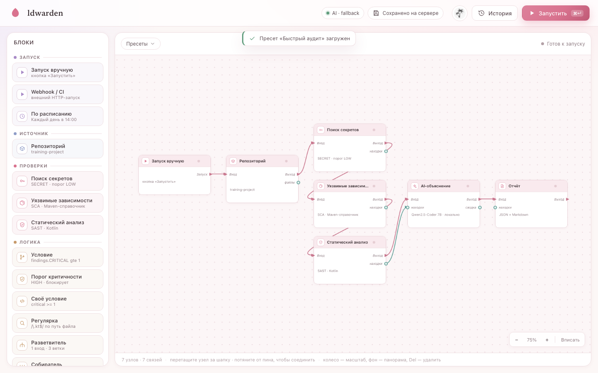
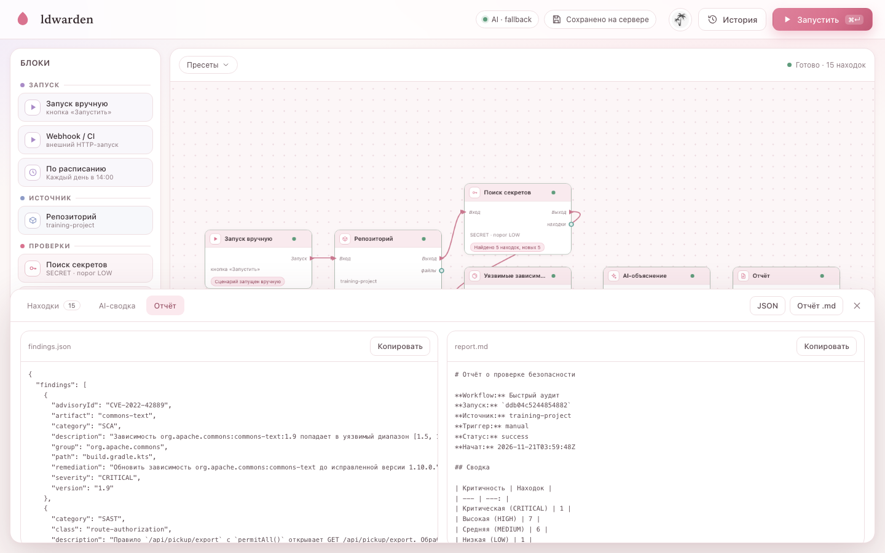

# LDWarden

Визуальный конструктор проверок безопасности для Kotlin / Spring Boot / Gradle.
Собираете сценарий из блоков на холсте — получаете находки SECRET / SCA / SAST,
объяснения и рекомендации по каждой находке и готовый отчёт.




## Запуск одним файлом

В корне проекта есть готовые файлы запуска — ничего вводить в терминал не нужно.

| ОС | Файл | Что происходит |
| --- | --- | --- |
| **macOS** | `LDWarden.command` — двойной клик | открывается окно Terminal, создаётся `venv`, ставятся зависимости, поднимается сервер и сайт в браузере |
| **Windows** | `start.bat` — двойной клик | то же самое в окне консоли |
| **Linux** | `./LDWarden.command` | то же самое, браузер открывается через `xdg-open` |

**Окно открыто — сервер работает. Закрыли окно (или нажали Ctrl+C) — сервер остановился.**
Если сервер уже был запущен раньше, файл сам остановит старый экземпляр и поднимет новый под своим управлением.
Порт по умолчанию `8000`; поменять можно так: `LDWARDEN_PORT=9000 ./LDWarden.command`.

### Через терминал

```bash
git clone https://github.com/dajers/ldwarden.git
cd ldwarden
./start.sh
```

Откройте <http://127.0.0.1:8000>. Первый запуск занимает 1–2 минуты: скрипт сам создаст `venv`, поставит зависимости и поднимет сервер. Повторный запуск — `./start.sh --no-install`.

Требуется Python 3.10+ (проверено на 3.14).

## Что есть на данный момент

### Конструктор

- Холст с перетаскиванием, панорамой и зумом, кнопка «Вписать» показывает граф целиком.
- Ноды с портами и подписями, ветвление по «Да / Нет», несколько входов и выходов.
- Цвета узлов и связей — сохраняются в сценарии и не сбиваются темой.
- Четыре темы: «Сакура», «Гавайи», «Чёрно-белый», «Варден» — переключаются кнопкой-стикером в шапке.
- В гавайской теме: пальмовые листья на фоне палитры, кокосы на карточках и обезьянка, которая подпрыгивает и «нажимает» кнопку «Запустить».

### Ноды

| Группа | Ноды |
| --- | --- |
| Запуск | вручную, webhook/CI, по расписанию (cron) |
| Источник | репозиторий: папка на диске или Git-URL (при включённом allow-list) |
| Проверки | поиск секретов, SCA по Gradle, статический анализ Kotlin |
| Логика | условие, сравнение, регулярка, своё выражение, разветвитель, собиратель, порог критичности |
| Действия | AI-объяснение, уведомление (webhook / Telegram / SMTP), отчёт |

### Пресеты

Шесть готовых сценариев в кнопке «Пресеты»:

- **Быстрый аудит** — три сканера подряд, AI и отчёт; на учебном проекте 15 находок;
- **Только секреты** — расписание → поиск секретов → уведомление;
- **Секреты в конфигах** — регулярка по пути `\.(ya?ml|properties|env|conf)$`;
- **Проверки авторизации** — регулярка по классу `route-authorization|object-authorization`;
- **Уязвимые зависимости по CVE** — регулярка по сообщению `CVE-\d{4}-\d{4,}`, запуск по расписанию;
- **Перед релизом** — полный аудит, ветвление по порогу и уведомление.

### Анализаторы (свои, без внешних SaaS)

- **SECRET** — пароли, токены, ключи, строки подключения, значения по умолчанию в коде.
- **SCA** — версии зависимостей из `build.gradle.kts` / `libs.versions.toml` и сверка со справочником уязвимостей.
- **SAST** — SQL-инъекции, отключённая проверка TLS, CORS с credentials, маршруты без авторизации, IDOR.

Сверка с эталоном организаторов на `training-main`: **15 из 15 находок, ложных срабатываний нет**.

### AI

- По умолчанию — **fallback**: объяснения и рекомендации формируются по правилам, мгновенно и без нагрузки на CPU.
- Опционально подключается **локальная Qwen** (GGUF + llama.cpp), Ollama или любой OpenAI-совместимый API — см. раздел ниже.

### Отчёты и результаты

- Markdown для человека, JSON для автоматики, SARIF для GitHub Code Scanning, **HTML** — self-contained файл с оформлением под печать.
- В интерфейсе: находки со статистикой по критичности, карточка находки с «почему это важно» и «как исправить», AI-сводка, текст отчёта, экспорт `JSON`, `Отчёт .md` и `Отчёт .html`.
- История прогонов в браузере.

### Запуск и интеграции

- Ручной запуск, расписание, вебхук с HMAC-подписью, CI (`POST /api/ci/run`).
- Готовые сниппеты для GitHub Actions и GitLab CI: `GET /api/ci/snippets`.
- Уведомления: webhook, Telegram, SMTP, локальный демо-ящик.
- REST API и SSE-стриминг событий прогона; спецификация — `/api/openapi.json`.

### Безопасность самого инструмента

- Секреты (токены, пароли) шифруются в БД и маскируются в интерфейсе.
- Опциональные токены API и CI, HMAC для вебхуков.
- Анализаторы работают локально и не отправляют код наружу.

### Ограничения

- Локальный инструмент: сканирует **любую доступную папку** — запускайте в изолированном окружении.
- Правила заточены под Kotlin / Spring Boot / Gradle; другие стеки требуют расширения правил.
- Локальная модель по умолчанию не подключена (fallback быстрее и не грузит машину).
- HTML/PDF-отчёта пока нет — только Markdown, JSON и SARIF.
- Часть автотестов ещё в работе: `python -m unittest discover -s tests`.

## Демо за две минуты

1. «Пресеты» → «Быстрый аудит».
2. «Запустить» (или `Ctrl+Enter`).
3. Через несколько секунд: **15 находок** — 1 CRITICAL, 7 HIGH, 6 MEDIUM, 1 LOW.
4. Вкладки «Находки», «AI-сводка», «Отчёт»; экспорт `JSON`, `Отчёт .md` и `Отчёт .html` (открывается в браузере, печатается в PDF).

## AI: локальная Qwen (опционально)

По умолчанию модель **не используется**: AI-нода работает в fallback-режиме — объяснения и рекомендации формируются по правилам, за доли секунды и без нагрузки на CPU.

Подключение модели даёт более живые тексты, но заметно грузит машину: 7B на CPU объясняет 5 находок примерно за 2 минуты,
15 находок — за 6–7 минут.

### Вариант A. GGUF + llama.cpp (офлайн)

```bash
./scripts/setup-ai.sh qwen2.5-7b      # llama-cpp-python + загрузка модели (~4.7 ГБ)
./start.sh
```

Уже есть свой `.gguf` (например, из LM Studio):

```bash
./scripts/setup-ai.sh --path /полный/путь/qwen2.5-coder-7b-instruct-q4_k_m.gguf
```

| Модель | Файл | Размер | Замечание |
| --- | --- | --- | --- |
| Qwen2.5-Coder-7B-Instruct | `qwen2.5-coder-7b-instruct-q4_k_m.gguf` | ~4.7 ГБ | работает на CPU, хватает 8 ГБ RAM |
| Qwen3-14B | `Qwen3-14B-Q4_K_M.gguf` | ~9 ГБ | нужен `llama-cpp-python >= 0.3.8`, 16 ГБ RAM |

Файл можно просто положить в `llms/` — при `LDWARDEN_LLM_PROVIDER=auto` (по умолчанию) он подхватится сам.

**Важно для CPU-моделей.** Полный аудит — 15 находок, и промпт с ними не влезает в маленький контекст:

```env
LDWARDEN_LLM_N_CTX=16384      # 8192 не хватает на 15 находок — AI уйдёт в fallback
LDWARDEN_LLM_THREADS=8        # по числу ядер
LDWARDEN_LLM_MAX_FINDINGS=8   # для быстрого демо: объяснить 8 самых серьёзных
```

Таймаут AI-ноды — 600 секунд, чтобы модель успевала ответить на CPU.

### Вариант B. Ollama

```bash
ollama pull qwen2.5-coder:7b
LDWARDEN_LLM_PROVIDER=ollama ./start.sh
```

### Вариант C. LM Studio / любой OpenAI-совместимый API

В LM Studio: Developer → Start Server (порт 1234). Затем в `.env`:

```env
LDWARDEN_LLM_PROVIDER=openai
LDWARDEN_LLM_BASE_URL=http://127.0.0.1:1234/v1
LDWARDEN_LLM_MODEL=qwen2.5-coder-7b-instruct
```

Проверка: в шапке пилюля сменится с «AI · fallback» на «AI · локальная модель», а `/api/health` покажет `"llm": {"provider": "local", ...}`.

## Качество анализаторов

```bash
python -m app.main check
```

```
Эталон: 15 находок; найдено 15; пропущено 0
Controls: ложных срабатываний нет
```

## Настройки

Все параметры — переменными окружения или файлом `.env` в корне проекта (см. `.env.example`).

| Переменная | По умолчанию | Что делает |
| --- | --- | --- |
| `LDWARDEN_LLM_PROVIDER` | `auto` | `auto`, `local`, `ollama`, `openai`, `fake`, `none` |
| `LDWARDEN_LLM_MODEL_PATH` | `llms/qwen2.5-coder-7b-instruct-q4_k_m.gguf` | путь к GGUF |
| `LDWARDEN_LLM_N_CTX` | `4096` | контекст модели (для 15 находок — `16384`) |
| `LDWARDEN_LLM_THREADS` | `4` | потоков на CPU |
| `LDWARDEN_LLM_MAX_FINDINGS` | `30` | сколько находок отдавать модели |
| `LDWARDEN_API_TOKEN` | — | включает авторизацию API |
| `LDWARDEN_DEFAULT_TARGET` | `training-main/training-project` | проект по умолчанию |
| `LDWARDEN_TELEGRAM_BOT_TOKEN` / `..._CHAT_ID` | — | уведомления в Telegram |

## CI

```bash
curl -s -X POST http://127.0.0.1:8000/api/ci/run \
  -H "X-CI-Token: $LDWARDEN_CI_TOKEN" \
  -d '{"workflow_id": "<id>"}'
```

Готовые сниппеты для GitHub Actions и GitLab CI: `GET /api/ci/snippets`.

## Тесты

```bash
python -m unittest discover -s tests
```

## Структура

```
LDWarden.command  запуск двойным кликом (macOS/Linux)
start.bat         запуск двойным кликом (Windows)
start.sh          запуск из терминала: venv, зависимости, сервер
scripts/          setup-ai.sh, download-model.sh
docs/             скриншоты для README

app/analysis/     SECRET, SCA, SAST — правила и парсеры Gradle
app/nodes/        ноды конструктора (сканеры, условия, уведомления, отчёты)
app/ai/           провайдеры LLM, промпты, схемы ответа
app/api/          REST API, SSE-стриминг прогонов, CI, вебхуки
app/frontend/     SPA-конструктор (без сборки, ES-модули)
app/reports/      Markdown / JSON / SARIF
training-main/    учебный проект и эталон находок
```
